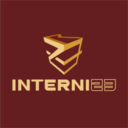

# Portfolio Case Study: internize.ai
### On-Device Clinical Decision Support & Sp.PD Workflow Cockpit

<div align="center">
  
  <h2>internize.ai — Clinical Intelligence Platform</h2>
  <p><strong>Arsitektur On-Device Zero Egress • Ekstensi Chrome MV3 • PWA Vercel • Google Sites / Apps Script Portal</strong></p>

  <p>
    <a href="https://internizeai.vercel.app"></a>
    <a href="https://script.google.com/macros/s/AKfycbzt_iLfalvX8Csm3ULI5oxJPdswUoJ66zXVe8EdeBVcGYHXXe2lEzNCueUBIGIS2FLG/exec"></a>
    <a href="https://internizeai.vercel.app/internize-ai-extension.zip"></a>
    <a href="https://github.com/indra-dot/internize.ai"></a>
  </p>
</div>

---

## 📌 Executive Summary

**internize.ai** adalah asisten kecerdasan klinis (*Clinical Decision Support System / CDSS*) dan percepatan alur kerja medis yang dikembangkan secara spesifik untuk **Dokter Spesialis Penyakit Dalam (Sp.PD)**, **Residen / PPDS**, dan **Dokter Umum** di Indonesia. 

Aplikasi ini mengatasi dua tantangan terbesar dalam digitalisasi layanan kesehatan:
1. **Beban Kognitif & Administratif Tinggi**: Dokter harus menelaah rekam medis panjang, menghitung skor risiko perioperatif rumit (Lee RCRI, ARISCAT, Caprini), dan menyusun asesmen POMR 4P berbasis ratusan Panduan Praktik Klinis (PPK) PAPDI di tengah keterbatasan waktu visite dan IGD.
2. **Kepatuhan Privasi Data Pasien (Zero-Egress Invariant)**: Berdasarkan UU Perlindungan Data Pribadi (UU PDP No. 27/2022) dan standar kerahasiaan medis, data klinis pasien (*Protected Health Information / PHI*) **tidak boleh** dikirim ke sembarang API LLM pihak ketiga tanpa persetujuan ketat.

**internize.ai memecahkan masalah ini dengan arsitektur 100% On-Device:** Seluruh ekstraksi entitas, parsing singkatan lab Indonesia, skoring risiko, dan pencarian basis pengetahuan PPK dieksekusi secara lokal di peramban pengguna (*browser runtime*) tanpa egress data.

---

## 🌐 Live Demonstrations & Tautan Publik

| Channel Distribusi | Akses Langsung | Deskripsi |
| :--- | :--- | :--- |
| **🚀 Production Web App** | [internizeai.vercel.app](https://internizeai.vercel.app) | Aplikasi web PWA responsif dengan Cross-Origin Isolation (COOP/COEP) untuk akselerasi WASM & WebGPU. |
| **🔗 Google Sites / Apps Script Portal** | [Buka Google Apps Script Web App](https://script.google.com/macros/s/AKfycbzt_iLfalvX8Csm3ULI5oxJPdswUoJ66zXVe8EdeBVcGYHXXe2lEzNCueUBIGIS2FLG/exec) | Widget interaktif terintegrasi untuk disematkan di Google Sites resmi klinisi. |
| **📦 Chrome Extension Package** | [Download internize-ai-extension.zip](https://internizeai.vercel.app/internize-ai-extension.zip) | Ekstensi peramban (Manifest V3) siap pasang di Google Chrome / Microsoft Edge untuk mendampingi SIMRS/EHR. |
| **📂 Source Code Repository** | [github.com/indra-dot/internize.ai](https://github.com/indra-dot/internize.ai) | Kode sumber terbuka, test suite komprehensif, dan dokumentasi arsitektur. |

---

## 🛠️ Tech Stack & Arsitektur Rekayasa

```
┌─────────────────────────────────────────────────────────────────────────┐
│                           internize.ai Ecosystem                        │
├──────────────────────────┬──────────────────────────┬───────────────────┤
│    Google Sites Portal   │     Vercel Production    │   Chrome MV3 Ext  │
│  (Apps Script Web App)   │   (PWA + Asset Delivery) │ (Sidepanel SIMRS) │
└─────────────┬────────────┴─────────────┬────────────┴──────────┬────────┘
              │                          │                       │
              └──────────────────────────┼───────────────────────┘
                                         ▼
┌─────────────────────────────────────────────────────────────────────────┐
│                    In-Browser Execution Engine                          │
│                                                                         │
│  ┌──────────────────────┐ ┌──────────────────────┐ ┌─────────────────┐  │
│  │ Indonesian Shorthand │ │   PPK Knowledge      │ │   On-Device     │  │
│  │   Parser & Guards    │ │    Store (JSON)      │ │   Transformers  │  │
│  │  (CRT, Vit-K, Vitals)│ │  (<2ms in-memory)    │ │   (WASM/WebGPU) │  │
│  └──────────┬───────────┘ └──────────┬───────────┘ └────────┬────────┘  │
│             │                        │                      │           │
│             ▼                        ▼                      ▼           │
│  ┌───────────────────────────────────────────────────────────────────┐  │
│  │           Core Clinical Modes (SpPdWorkflowPanel)                 │  │
│  │   1. Jawab Konsul TS (Pre-op Lee RCRI, Rawat Bersama, CITO)       │  │
│  │   2. Periksa Pasien POMR (11 Divisi PAPDI, Pdx/Ptx/Pmx/Pex)       │  │
│  │   3. Ringkas Kasus (Kronologi, RPD/RPO, Abnormal Lab Trend)       │  │
│  └───────────────────────────────────┬───────────────────────────────┘  │
│                                      ▼                                  │
│  ┌───────────────────────────────────────────────────────────────────┐  │
│  │       Interoperability & Export: FHIR R4, LOINC, SNOMED, CPPT     │  │
│  └───────────────────────────────────────────────────────────────────┘  │
└─────────────────────────────────────────────────────────────────────────┘
```

### 1. Frontend & Runtime
- **React 18 & TypeScript 5.6**: Komponen antarmuka yang strictly-typed, modular, dan teroptimasi untuk performa tinggi.
- **Tailwind CSS & Biome**: Desain sistem bernuansa *Deep Maroon (`#4A151B`)* dan *Warm Gold (`#CDA258`)* dengan standarisasi linting dan formatting ketat.
- **Vite 5.4 & CRXJS**: Dual-target build pipeline yang mampu mengompilasi Web PWA statis dan Chrome Extension MV3 secara simultan.

### 2. On-Device AI & Deterministic Engine
- **Deterministic Clinical Rule Engine (CROGE)**: Mengeliminasi risiko halusinasi generatif pada kalkulasi dosis, kelaikan operasi, dan target glikemik.
- **Tesseract.js OCR**: Ekstraksi teks dari foto hasil laboratorium dan lembar konsul fisik langsung di peramban tanpa koneksi cloud.
- **@huggingface/transformers (WASM/WebGPU)**: Model inferensi on-device untuk klasifikasi teks dan ekstraksi entitas klinis lokal.

### 3. Basis Pengetahuan 121 PPK PAPDI
- **PpkKnowledgeEngine**: Basis pengetahuan terstruktur hasil ekstraksi 122 dokumen klinis resmi dari 9 divisi PAPDI (`ppkStore.json`, berukuran ~350 KB, waktu pencarian sub-2 milidetik).
- **Penyesuaian Parameter Pasien Otomatis**: Titrasi dosis otomatis berdasarkan estimasi laju filtrasi glomerulus (eGFR ginjal), enzim hepar (SGOT/SGPT), dan usia geriatri.

---

## 🎯 3 Alur Kerja Klinis Unggulan

### 1. Jawab Konsul TS (Teman Sejawat)
Menyusun telaah jawaban konsul dari departemen Bedah, Obgyn, atau unit rawat intensif dalam hitungan detik:
- **Pre-Operative Clearance**:
  - Kalkulasi instan **Lee RCRI** (Cardiac Risk) dan **ARISCAT** (Pulmonary Risk).
  - Verifikasi target kelaikan operasi: Tensi (<160/90), Gula Darah (<200 mg/dL), Hb (>10 g/dL), Kalium (3.5 - 5.5 mEq/L).
  - Rekomendasi perioperatif: bridging antikoagulan/antiplatelet, pengaturan insulin/OHO, dan premedikasi.
- **Rawat Bersama**: Pembagian wewenang tata laksana medis pada kasus multi-morbiditas.
- **Evaluasi CITO**: Penanganan krisis ketoasidosis diabetik (KAD/HHS), badai tiroid, dan syok sepsis.

### 2. Periksa Pasien (POMR 4P)
Standardisasi pencatatan rekam medis berbasis masalah (*Problem Oriented Medical Record*) menurut **11 Divisi PAPDI**:
- **Pdx (Planning Diagnostik)**: Rencana pemeriksaan penunjang terarah.
- **Ptx (Planning Terapi)**: Rekomendasi farmakoterapi lini pertama sesuai konsensus nasional.
- **Pmx (Planning Monitoring)**: Parameter target harian (balans cairan, hemodinamik, elektrolit serial).
- **Pex (Planning Edukasi)**: Materi edukasi diet, restriksi cairan, dan tanda bahaya komplikasi.

### 3. Ringkas Kasus (Discharge Summary & Operan Jaga)
- Rekapitulasi kronologis problem aktif pasien rawat inap.
- Deteksi nilai laboratorium kritis (*Critical Lab Keep & Highlighting*).
- Kompilasi ringkas untuk lembar transfer antar ruangan atau resume medis kepulangan.

---

## 🛡️ Guardrail Keamanan & Parsing Shorthand Medis Indonesia

Dokumentasi medis di Indonesia kaya akan singkatan khas dan format tulisan tangan cepat. Sistem ini memiliki filter proteksi khusus:

| Potensi Konflik / Kesalahan | Solusi internize.ai Guardrail |
| :--- | :--- |
| `T: 120/80` disalahartikan sebagai Temperatur | **Vitals Disambiguation**: Mengenali `T:` / `TD:` sebagai Tensi / Tekanan Darah; `S:` / `Suhu:` sebagai temperatur tubuh. |
| `Vitamin K 10 mg` memicu alarm hiperkalemia | **Anti-Collision Lookaround**: Mencegah kata "Vitamin K" memicu kalkulasi elektrolit kalium serum. |
| `CR: 2 detik` memicu alarm gagal ginjal | **CRT vs Kreatinin Guard**: Membedakan Capillary Refill Time (detik) dari kreatinin serum (mg/dL). |
| Header `Monitoring BS:\n3/10/26` terbaca GDS = 3 | **Anti-Date Delimiter Guard**: Menolak angka yang diikuti pemisah tanggal (`/` atau `-`) dari ekstraksi nilai gula darah. |
| Format angka Indonesia `1.050.000 /uL` | **Multi-dot Thousand Formatting**: Parsing format ribuan titik tanpa terpotong desimal. |

---

## 📊 Kualitas & Verifikasi Pengujian

Proyek ini menerapkan standar rekayasa perangkat lunak yang ketat untuk menjamin keandalan klinis:

- ✅ **605 Unit & Integration Tests Passing**: 35 test suites lulus 100% tanpa kegagalan (`npm test`).
- ✅ **Zero Egress Verification (`test_cloud_guardrail.test.ts`)**: Uji coba otomatis yang memastikan tidak ada kebocoran token NIK, nomor rekam medis, alamat, atau nomor telepon ke jaringan luar.
- ✅ **Cross-Origin Isolation**: Konfigurasi header COOP/COEP terverifikasi pada infrastruktur Vercel untuk mendukung WebAssembly multi-threaded.
- ✅ **In-App Auto-Update Checker**: Verifikasi dynamic endpoint `version.json` yang menjaga ekstensi peramban tetap up-to-date dengan versi rilis terkini.

---

## 👨‍💻 Kontribusi & Kepemilikan Proyek

- **Author / Lead Engineer**: dr. Indra & Tim Pengembang internize.ai
- **Afiliasi**: Inisiatif HealthTech & Clinical Decision Support Spesialis Penyakit Dalam Indonesia.
- **Lisensi**: MIT License — Terbuka untuk adopsi dan kolaborasi institusi layanan kesehatan di Indonesia.
